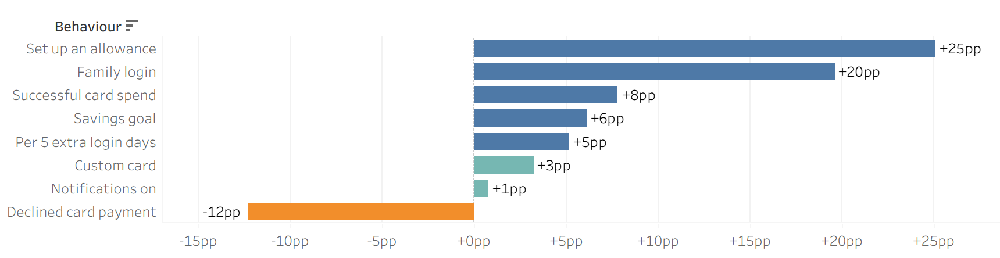
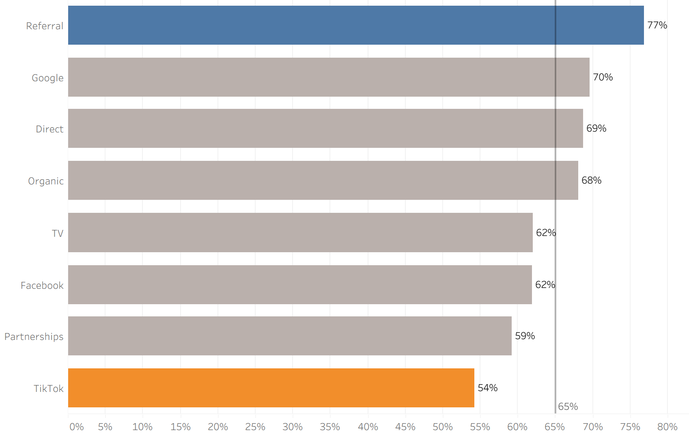
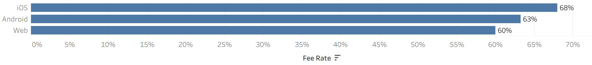

# What predicts a customer paying their first monthly fee?

A take-home case study for a Data Analyst role at a UK children's fintech app (a subscription-based debit card and money app for kids, managed by parents). The brief asked three questions about ~5,000 customers who signed up in 2024:

1. Which first-30-day behaviours are associated with the first monthly fee being collected (`fee_collected_m1`)?
2. How does this differ by platform, subscription tier and acquisition channel?
3. What should the product team do about it, and how should success be measured?

The deliverable was an 8-slide deck for the Head of Product and the Head of Data: [`presentation/first_fee_analysis.pdf`](presentation/first_fee_analysis.pdf).

**Stack:** PostgreSQL (validation, cleaning, aggregation) · Python with pandas, statsmodels and SciPy (logistic regression, significance tests, sizing, power) · Tableau (charts) · PowerPoint (deck)

## Headline results

| | Finding |
|---|---|
| **Funnel** | 84.7% of signups activate their card and 65.1% of those pay, so 55.1% of all signups pay. **No one who failed to activate paid.** They make up 34% of all non-payers, so activation is a lever in its own right. |
| **Behaviours** | After adjusting for everything else (logistic regression, n = 4,236 activated users): setting up an **allowance +25pp**, **parent and child logging in together +20pp**, and a **declined card payment −12pp**. Families with both habits pay 94% of the time; families with neither, 49%. |
| **Not levers** | Notifications (+1pp) and custom cards (+3pp) aren't statistically significant. Subscription tier and signup month make no difference. |
| **Segments** | Referral customers pay most (77%) and TikTok least (54%). Web trails iOS by 8pp. These gaps remain after controlling for behaviour. |
| **Recommendations** | Activation nudges (+1.8pp of all signups paying), allowance and family login built into onboarding (+1.1pp), and a top-up prompt after a declined payment (+0.4pp). The estimates are deliberately conservative, and each change should run as an A/B test (~4,300 users per group to detect +3pp). |

<p align="center">
  
</p>

| Fee rate by acquisition channel | Fee rate by platform |
|---|---|
|  |  |

## How the pipeline works

```
Excel workbook ──► PostgreSQL ──► sql/01 validate ──► sql/02 analysis view ──► sql/03 aggregates
                                                                                    │
            Tableau ◄── outputs/*.csv ◄── Python: regression, tests, sizing, power ◄─┘
```

**Division of work:** SQL does the validation, cleaning and aggregation. Python does what SQL can't do well: significance tests, logistic regression, opportunity sizing and power calculations. Tableau draws every chart from the exported CSVs.

The script stops with an error if any blocking data-quality check fails or if the SQL and pandas numbers don't match.

## Data

The dataset was supplied by the company for the take-home and **is not included in this repository**. It is dummy data with one row per customer: signup attributes, first-30-day behaviour flags and counts, and whether the first fee was collected. A channel lookup and a field glossary come with it. Everything derived from it at aggregate level (all of `outputs/`) is included, so every number in the deck can be traced.

The Tableau workbook is also kept out of the repo, because the packaged `.twbx` embeds the customer-level data. The charts are in `Screenshots/` and in the deck.

## How to run

Requires Python 3.14 and a running PostgreSQL server. Place the workbook at `Data/raw/Data Analyst Take Home Task (1).xlsx`.

The connection uses the standard PostgreSQL environment variables. Defaults: `PGUSER=postgres`, `PGHOST=localhost`, `PGPORT=5432`, `PGDATABASE=Interview`. The password comes from `PGPASSWORD` or from `%APPDATA%\postgresql\pgpass.conf` and is never stored in the code.

```powershell
python -m venv .venv
.\.venv\Scripts\python.exe -m pip install -r requirements.txt
$env:PGPASSWORD = "<your password>"   # or use pgpass.conf
.\.venv\Scripts\python.exe python\analysis.py
```

The script loads the workbook into a `fee_analysis` schema, which it drops and rebuilds on every run, and then runs the SQL files there. It rewrites everything in `outputs/` and `Data/processed/` on every run. After a run, you can query every table and view in the `fee_analysis` schema yourself, e.g. in pgAdmin.

To work interactively, open `python/analysis.py` in VS Code with the `.venv` interpreter and run the `# %%` cells one at a time (Shift+Enter).

## Project structure

```
sql/01_load_and_validate.sql   22 data-quality checks on the raw tables
sql/02_analytical_view.sql     staging (types) -> v_customers analysis view (channel names, bands, flags)
sql/03_aggregates.sql          funnel, behaviour lift, dose-response, segments
sql/explore/explore.sql        my exploration queries, each with the question and what I found
python/analysis.py             loads the data into PostgreSQL, runs the SQL, then the statistics, then writes outputs/
outputs/                       every number used in the deck (CSV + regression_summary.txt)
Screenshots/                   Tableau charts used in the deck
presentation/                  slide deck (PDF and PowerPoint, with speaker notes)
Assumptions_and_Findings.md    assumptions log and how each finding was checked
Data/                          raw and processed data (local only, not in the repo)
```

## Key decisions and assumptions

1. **Behaviours are analysed on activated users only (n = 4,236).** The 764 users who never activated show no engagement at all and were never charged (0% fee collection). Including them would make every behaviour look predictive just because it signals activation, which is target leakage. Activation is treated as its own funnel stage. The hiring team confirmed this was the correct approach.
2. **The results show which behaviours go together with paying, not that the behaviours cause paying.** Parents who are keen on the product tend to set up an allowance, log in with their child *and* pay, so part of the gap comes from who these parents are, not from the allowance itself. Pushing an allowance on a less keen parent will therefore raise payment by less than the gap suggests. That's why `opportunity_sizing.csv` counts only 25–75% of each effect, and why each recommendation should be tested with an A/B test before rollout.
3. **Timing (assumption):** the first fee is assumed to be attempted at or after the end of the 30-day window, so the behaviours come before the outcome. If the fee is taken earlier, some behaviours may be a reaction to it (reverse causality).
4. **Why fees fail is unknown** (failed payment vs cancellation).
5. **Data-quality anomalies are kept and flagged, not deleted.** Rerunning without the 4 planted rows gives the same answer: the family-login gap is 21.28pp with them and 21.30pp without (`analysis.py` cell 4).
6. `allowance_amount` is the total weekly allowance for all children, as defined in the glossary. The hiring team confirmed this, although the data looked like it might be per child.

## Data-quality log

Full results are in `outputs/validation_log.csv`. There are 22 checks covering grain, nulls, value domains, referential integrity, flag vs count consistency, plausibility and funnel order.

| Finding | Rows | Treatment |
|---|---|---|
| Family login recorded but parent login count = 0 (contradicts the definition) | 4 | Kept, flagged as `dq_flag_family_login`. The family-login lift is 21.28pp with these rows and 21.30pp without them. **The hiring team confirmed this was a deliberately planted data-quality issue.** |
| `login_count` = 30, but the glossary counts logins *after* signup day | 8 | Kept. **Confirmed as expected**, so no special treatment |
| Median `allowance_amount` is ~£24.5 whatever the number of children, even though it's defined as the total | – | Raised as a question. **Confirmed it should be treated as the total for all children** (`dq_allowance_by_children.csv`) |
| Counts and `channel_id` are stored as floats | all | Cast to integers in `stg_customers` after checking they are whole numbers |
| Activated users who never logged in | 46 | Info only. The `has_login` lift is based on this tiny group, so `login_count` is used instead |

All other checks pass: unique `user_id`, no nulls, all dates in 2024, every channel maps to the lookup, every flag matches its count or amount, and no non-activated user has engagement or paid a fee.

## Methods

| Question | Method | Output file |
|---|---|---|
| Data quality (slide 3) | 22 SQL checks; 4 planted rows kept and flagged; sensitivity check with and without them | `validation_log.csv` |
| Q1 raw comparisons | Fee rate with vs without each behaviour (SQL) | `agg_behaviour_lift.csv` |
| Q1 strength of the relationship (slide 5) | Fee rate by band of each count or amount; allowance × family login 2×2 | `agg_dose_response.csv`, `agg_allowance_family_matrix.csv` |
| Q1 + Q2 adjusted (slides 4, 6) | Logistic regression on activated users (behaviours + platform + tier + channel + children), reported as average marginal effects in pp with 95% CIs and p-values (p ≥ 0.05 = could be chance) | `marginal_effects.csv`, `regression_summary.txt` |
| Do the two habits interact? (slide 5) | Likelihood-ratio test of an allowance × family login interaction (p = 0.05, borderline, so described as "mostly add up") | `model_metrics.csv` |
| Q2 segments (slide 6) | Activation and fee rate by segment with 95% CIs; segment rates split by allowance | `agg_segments.csv`, `agg_segment_by_allowance.csv` |
| Q3 sizing (slide 7) | Low / central / high scenarios using adjusted effects × an assumed causal share | `opportunity_sizing.csv` |
| Q3 measurement (slide 8) | Sample size per group for a two-sided test at α = 5% and 80% power | `power_calc.csv` |

Confidence intervals in the SQL tables use the normal approximation `1.96 × √(p(1−p)/n)`, the same formula as the Tableau calculated field.

## Number → source map

`outputs/key_numbers.csv` lists the headline numbers in the deck and the file each one comes from.

## Limitations

- The results are associations, not proven causes; the recommendations need A/B tests.
- The fee timing and the reasons for failed fees would need confirming with real data.
- The dataset is synthetic: the behaviours are almost uncorrelated with each other, which is unusual in real product data.
